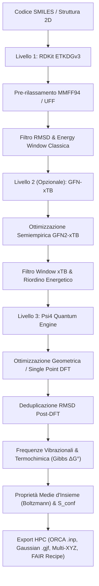

# Energyinator

**Framework Ibrido ad Alta Efficienza per il Campionamento Conformazionale, Screening Semiempirico (GFN-xTB) e Chimica Quantistica (Psi4)**

Energyinator è una piattaforma integrata in Python progettata per automatizzare la ricerca conformazionale tridimensionale e la caratterizzazione quantomeccanica accurata di sistemi molecolari organici partendo da semplici stringhe SMILES o file di struttura. Il software implementa un **workflow gerarchico a 3 livelli** che massimizza il compromesso tra accuratezza scientifica e tempo computazionale, integrando:

1. **RDKit**: Generazione stocastica di conformeri (algoritmo ETKDGv3) e pre-rilassamento con campi di forze classici (**MMFF94 / UFF**).
2. **GFN-xTB (Grimme Lab, Bonn)**: Raffinamento e filtraggio quantistico semiempirico preliminare ad altissima velocità (**GFN2-xTB / GFN1-xTB / GFN-FF**).
3. **Psi4**: Calcolo quantomeccanico *ab initio* ad alta precisione (**DFT** con correzioni di dispersione empirica, **HF**, **MP2**), solvatazione implicita continua (IEFPCM) e frequenze vibrazionali.

La piattaforma include un **Molecular Studio interattivo in Streamlit** dotato di editor 2D, visualizzatore 3D WebGL con rendering di **isosuperfici orbitaliche (HOMO/LUMO)**, scansioni di potenziale torsionale rilassate (PES 1D e mappe 2D), calcolo delle **proprietà macroscopiche medie d'insieme (Boltzmann)**, una **suite di benchmark e validazione scientifica** ed esportazione automatica per **cluster di calcolo HPC (ORCA e Gaussian)** conforme ai principi **FAIR**.

---

## Architettura del Workflow a 3 Livelli



---

## Caratteristiche Principali

### 1. Campionamento e Filtraggio Conformazionale
* **Generazione Stocastica Multithread**: Campionamento geometrico mediante l'algoritmo ETKDGv3 di RDKit con gestione di chiralità e anelli complessi.
* **Supporto Campi di Forza Avanzati**: Pre-rilassamento geometrico con **MMFF94** (o MMFF94s), con fallback intelligente su **UFF**.
* **Doppia Deduplicazione RMSD (Pre & Post-DFT)**: Eliminazione preventiva dei duplicati classici e rimozione post-calcolo quantistico dei conformeri collassati nello stesso minimo locale (`GetBestRMS` con automorfismi di simmetria).
* **Riconoscimento Automatico di Stato Elettronico**: Rilevamento automatico della carica formale netta e della molteplicità di spin ($2S+1$), con opzione di override manuale.

### 2. Tier Intermedio Semiempirico Quantistico (GFN-xTB)
* **Integrazione Nativa con la suite xTB**: Implementazione dei metodi tight-binding del gruppo di Stefan Grimme (**GFN2-xTB**, GFN1-xTB, GFN-FF).
* **Accelerazione Drastica del DFT**: I conformeri generati vengono pre-ottimizzati a livello semiempirico in pochi secondi; Psi4 riceve geometrie quantistiche già vicine al minimo reale, abbattendo il numero di cicli SCF e gradient steps.
* **Filtraggio su Finestra Energetica xTB**: Esclusione automatica degli isomeri torsionali ad alta energia prima dei costosi calcoli DFT ab initio.

### 3. Motore Quantistico Psi4 (DFT & Ab Initio)
* **Ampia Scelta di Funzionali e Basi**: DFT ibrida (`B3LYP`, `wB97X-D`, `PBE`), metodi ab-initio (`HF`, `MP2`) combinabili con set di basi standard (`6-31G(d)`, `6-311+G(d,p)`, `def2-SVP`, `3-21G`, `STO-3G`).
* **Modello di Solvatazione Implicita (IEFPCM)**: Simulazione continua del dielettrico in fase liquida per acqua, cloroformio, DMSO, metanolo, toluene, acetonitrile e diclorometano.
* **Termochimica Vibrazionale Completa**: Calcolo delle frequenze armoniche per determinare l'energia di punto zero (ZPVE), l'entalpia ($H$), l'entropia molecolare ($S$) e l'energia libera reale di Gibbs ($\Delta G^\circ_{298}$).

### 4. Termodinamica d'Insieme (Ensemble Averaging)
* **Medie di Boltzmann Osservabili Sperimentalmente**: Calcolo delle proprietà macroscopiche medie ponderate sulla distribuzione statistica dei conformeri:
  $$\langle \mu \rangle = \sum_i p_i \mu_i \quad (\text{Dipolo medio osservabile}) \qquad \langle \text{Gap} \rangle = \sum_i p_i \Delta E_{\text{HOMO-LUMO}, i}$$
* **Entropia Conformazionale di Miscelamento ($S_{\text{conf}}$)**: Quantificazione del contributo entropico derivante dalla flessibilità molecolare:
  $$S_{\text{conf}} = -R \sum_{i=1}^{N} p_i \ln p_i, \quad \Delta G_{\text{conf}} = -T S_{\text{conf}}$$
* **Gestione degli Stati Degeneri ($g_i$)**: Raggruppamento termodinamico di microstati degeneri per simmetria per calcolare le reali popolazioni di Boltzmann d'equilibrio.

### 5. Visualizzazione 3D & Isosuperfici Orbitaliche (HOMO / LUMO)
* **Rendering Volumetrico Orbitali Molecolari**: Generazione automatica di file volumetrici Cube Psi4 (`CubeProperties`) e rendering tridimensionale interattivo delle superfici dei lobi d'onda orbitalici (positivo in blu, negativo in rosso) con isovalore e trasparenza configurabili.
* **Sovrapposizione Geometrica (Conformer Overlay)**: Allineamento con rotazione e traslazione ottimale di Kabsch (SVD) per confrontare visivamente ciascun conformero eccitato rispetto al minimo globale.
* **Ispettore Geometrico Integrato (Anti-Avogadro)**: Misurazione interattiva istantanea di distanze di legame (Å), angoli di valenza (°) e angoli diedri (°) con evidenziazione grafica degli atomi cliccati nel viewer.

### 6. Scansione Torsionale Rilassata (PES 1D e 2D)
* **Auto-Rilevamento Legami Rotatabili**: Identificazione algoritmica automatica di tutti i legami singoli $sp^3-sp^3$ o $sp^3-sp^2$ flessibili della molecola.
* **1D Relaxed PES Scan**: Calcolo continuo della curva energetica torsionale da $0^\circ$ a $360^\circ$ con rilassamento geometrico vincolato per rimuovere picchi sterici artificiali.
* **Mappe di Potenziale 2D (Ramachandran-like)**: Superfici 3D e mappe di contorno 2D interattive per esplorare coppie di rotori molecolari accoppiati.

### 7. Validazione Scientifica & Suite di Benchmark
* **Sistemi di Riferimento della Letteratura Accademica**:
  * **$n$-Butano**: Equilibrio torsionale Anti vs Gauche ($\Delta E_{\text{ref}} = 0.86\text{ kcal/mol}$, $\text{CCSD(T)/CBS}$, Dixon et al. 2000).
  * **1,2-Etandiolo**: Rottura del legame a idrogeno intramolecolare Gauche chelato vs Anti esteso ($\Delta E_{\text{ref}} = 1.95\text{ kcal/mol}$, Howard & Jardon 1998).
  * **Cicloesano**: Inversione d'anello Sedia vs Barca-Ritorta ($\Delta E_{\text{ref}} = 5.50\text{ kcal/mol}$, Squillacote et al. JACS).
* **Tracciamento Geometrico Automatico**: Identificazione dei conformeri target mediante misura degli angoli diedri caratteristici.
* **Reportistica Scientifica Esportabile**: Calcolo del Mean Absolute Error (MAE in kcal/mol), tabella CSV arricchita e relazione metodologica in Markdown (.md) pronta per pubblicazioni e tesi.

### 8. Interoperabilità FAIR & Cluster HPC
* **Generatore di Input per ORCA (`.inp`)**: Creazione di job per il software ORCA (`! B3LYP 6-31G(d) Opt TightSCF Grid5`, blocchi `%maxcore`, coordinate del minimo globale).
* **Generatore di Input per Gaussian (`.gjf` / `.com`)**: Route section con `%mem`, `%nprocshared`, coordinate e opzioni solvente.
* **Traiettoria Multi-Frame XYZ**: File `.xyz` concatenato compatibile nativamente con PyMOL, VMD, Avogadro, ChimeraX e Ovito per animare l'insieme conformazionale.
* **Metadati FAIR (`calculation_recipe.json`)**: Ricetta strutturata conforme ai principi FAIR che registra le versioni software, l'hardware, i tempi di calcolo e i parametri di convergenza.
* **Bundle Completo ZIP**: Download con un clic di tutti i risultati, grafici, coordinate e file di calcolo HPC in un unico archivio.

### 9. Editor Molecolare 2D Integrato (Ketcher) & PubChem Resolver
* **Ketcher 2D integrato**: Disegna e modifica strutture molecolari direttamente nell'interfaccia web, sincronizzate in tempo reale con lo SMILES.
* **Risolutore Nomi PubChem**: Digita un nome comune o commerciale (es. *ibuprofene*, *aspirina*, *taxolo*) per importare istantaneamente la struttura chimica ufficiale.

---

## Requisiti di Sistema

| Requisito | Minimo | Consigliato |
| :--- | :--- | :--- |
| **Sistema Operativo** | Windows 10/11 (64-bit), Linux (x86_64), macOS | Windows 11 o Linux Ubuntu 22.04+ |
| **Python** | 3.10 | 3.10 – 3.12 |
| **Gestore Pacchetti** | Miniconda o Anaconda | Miniconda |
| **RAM** | 8 GB | 16 GB+ |
| **CPU** | Quad-Core | 8+ Core (multithreading per Psi4, xTB e RDKit) |
| **Spazio su Disco** | 5 GB | 10 GB+ |

---

## Installazione Rapida

### 1. Clonazione del Repository
```bash
git clone https://github.com/sirfilips/energy-inator.git
cd energy-inator
```

### 2. Creazione dell'Ambiente Conda con tutte le dipendenze
L'ambiente include Python, Psi4, RDKit e la suite semiempirica GFN-xTB:

```bash
conda env create --prefix .\.venv -f environment.yml
conda activate .\.venv
```

Se disponi già di un ambiente Conda attivo:
```bash
conda install -c conda-forge psi4 rdkit xtb
pip install -r requirements.txt  # o pip install streamlit plotly py3dmol openpyxl tqdm streamlit-ketcher
```

---

## Utilizzo

### Interfaccia Grafica Web (Streamlit Molecular Studio)

Puoi avviare l'applicazione semplicemente facendo doppio clic sul file batch:
```text
avvia_gui.bat
```

Oppure da terminale:
```bash
streamlit run app_gui.py
```

L'interfaccia grafica è suddivisa in 5 schede specializzate:

1. **Struttura 3D e Geometria**:
   * Visualizzazione interattiva WebGL 3D (rotazione, zoom e traslazione).
   * **Isosuperficie Orbitale**: Rendering 3D volumetrico del **HOMO** o **LUMO** con isovalore e trasparenza regolabili.
   * **Ispettore Geometrico**: Misura distanze (Å), angoli (°) e diedri (°) cliccando sugli atomi.
   * **Conformer Overlay**: Allineamento Kabsch per sovrapporre qualsiasi rotamero al minimo globale.
2. **Scansione Torsionale (PES 1D e Mappa 2D)**:
   * Scansione potenziale 1D (rigida o vincolata rilassata) attorno a diedri selezionati con slider animato.
   * Mappa di contorno 2D e superficie 3D tipo Ramachandran per coppie di rotori.
3. **Analisi Energetica, Popolazioni ed Ensemble Thermodynamics**:
   * **Hero Summary**: Sintesi esecutiva con grandezze medie macroscopiche ($\langle\mu\rangle$, $\langle\text{Gap}\rangle$).
   * Diagramma a barre energetico ($\Delta E$ e $\Delta G^\circ$) e grafico a ciambella delle popolazioni di Boltzmann.
   * Scheda per il calcolo dell'**entropia conformazionale ($S_{\text{conf}}$)** e del termine libero $-TS_{\text{conf}}$.
4. **Tabella Dati ed Esportazione (HPC & FAIR)**:
   * Tabella completa di tutti i conformeri con energie relative, polarità, gap e conformazioni.
   * Download Excel (`.xlsx`), file coordinata `.xyz` del minimo globale e traiettoria `.xyz` multi-frame.
   * Download job pronti per il supercalcolo: **ORCA** (`.inp`) e **Gaussian** (`.gjf`).
   * Download file metadati di riproducibilità scientifica (`calculation_recipe.json`).
   * Download pacchetto compresso **ZIP completo**.
5. **Log di Calcolo**:
   * Registro di esecuzione in tempo reale e log scientifico dettagliato di Psi4 (`psi4_output.dat`).

---

## Opzioni da Riga di Comando (CLI)

Energyinator può essere eseguito anche via terminale in modalità singola o batch (utile per cluster o elaborazioni massive):

```bash
# Esecuzione standard con B3LYP/6-31G(d)
python -m energyinator.cli "CCCC" -n 30 -m b3lyp -b 6-31G(d)

# Workflow gerarchico a 3 livelli con pre-filtraggio semiempirico GFN2-xTB
python -m energyinator.cli "CCO" -n 50 --use-xtb --xtb-method gfn2 --xtb-window 6.0 --top-n 5

# Calcolo con solvatazione implicita in acqua e termochimica di Gibbs
python -m energyinator.cli "c1ccccc1O" --solvent water --frequencies -o ./risultati_fenolo
```

### Tabella Completa degli Argomenti CLI

| Parametro | Breve | Default | Descrizione |
| :--- | :--- | :--- | :--- |
| `smiles` | Posizionale | `None` | Stringa SMILES della molecola target |
| `--input-file` | `-f` | `None` | File `.txt` con lista di SMILES per elaborazione batch |
| `--n-conformers` | `-n` | `50` | Numero di conformeri stocastici da campionare |
| `--rmsd-threshold`| `-r` | `0.20` | Soglia RMSD classica (Å) per deduplicazione RDKit |
| `--post-dft-rmsd` | | `0.15` | Soglia RMSD (Å) post-DFT per deduplicare minimi collassati |
| `--ff` | | `mmff94` | Campo di forze classico (`mmff94`, `mmff94s`, `uff`) |
| `--energy-window` | `-w` | `10.0` | Finestra energetica FF in kcal/mol (0 per disattivare) |
| `--top-n` | | `None` | Limite massimo di conformeri unici inviati a Psi4 |
| `--use-xtb` | | `False` | **Abilita il tier intermedio semiempirico GFN-xTB** |
| `--xtb-method` | | `gfn2` | Metodo semiempirico (`gfn2`, `gfn1`, `gfnff`) |
| `--xtb-sp` | | `False` | Esegue solo Single-Point xTB anziché rilassamento geometrico |
| `--xtb-window` | | `6.0` | Finestra energetica xTB in kcal/mol per filtraggio pre-DFT |
| `--xtb-top-n` | | `None` | Numero massimo di conformeri xTB da inoltrare al DFT |
| `--method` | `-m` | `b3lyp` | Metodo quantistico (`b3lyp`, `wb97x-d`, `pbe`, `hf`, `mp2`) |
| `--basis` | `-b` | `6-31G(d)` | Basis set per Psi4 (`6-31G(d)`, `6-311+G(d,p)`, `def2-SVP`, ecc.) |
| `--solvent` | | `None` | Solvente implicito PCM (`water`, `chloroform`, `dmso`, ecc.) |
| `--frequencies` | | `False` | Calcola frequenze vibrazionali e $\Delta G^\circ$ di Gibbs |
| `--threads` | `-t` | `8` | Numero di thread CPU per il calcolo parallelo |
| `--memory` | | `'8 GB'` | Quantitativo massimo di RAM per Psi4 |
| `--sp-only` | | `False` | Solo Single-Point invece di ottimizzazione di geometria |
| `--charge` | | `Auto` | Carica formale molecolare forzata |
| `--multiplicity` | | `Auto` | Molteplicità di spin forzata |
| `--temp` | | `298.15` | Temperatura in Kelvin per la statistica di Boltzmann |
| `--output-dir` | `-o` | `output/` | Directory personalizzata di salvataggio |

---

## Test Unitari e Controllo Qualità

Il framework include una suite completa di 30 test unitari automatizzati basati su `pytest` che coprono tutti i moduli critici (generazione conformeri, xTB, chimica quantistica Psi4, calcolo orbitali cubici, geometria Kabsch, scansione PES, termodinamica d'insieme, benchmark e interoperabilità FAIR):

```bash
# Esecuzione della suite completa di test
python -m pytest -v
```

---

## Riferimenti Bibliografici e Citazioni

Se utilizzi **Energyinator** per attività di ricerca, tesi di laurea o pubblicazioni, si prega di citare gli strumenti teorici e computazionali alla base della piattaforma:

* **RDKit**: Landrum, G. et al. *RDKit: Open-source cheminformatics*. [https://www.rdkit.org](https://www.rdkit.org)
* **Psi4**: Smith, D. G. A. et al. *Psi4 1.4: Open-Source Software for High-Throughput Quantum Chemistry*. *J. Chem. Phys.* **2020**, 152, 184108.
* **GFN-xTB**: Bannwarth, C.; Ehlert, S.; Grimme, S. *GFN2-xTB—An Accurate and Broadly Parametrized Self-Consistent Tight-Binding Quantum Chemical Method*. *J. Chem. Theory Comput.* **2019**, 15, 3, 1652–1671.
* **Algoritmo ETKDGv3**: Wang, S.; Riniker, S. *Better Informed Distance Geometry: Using Classical Molecular Dynamics to Improve RDKit's Conformation Generation*. *J. Chem. Inf. Model.* **2020**, 60, 4, 2044–2058.
* **Allineamento Kabsch**: Kabsch, W. *A solution for the best rotation to relate two sets of vectors*. *Acta Cryst. A* **1976**, 32, 922–923.
* **FAIR Guiding Principles**: Wilkinson, M. D. et al. *The FAIR Guiding Principles for scientific data management and stewardship*. *Sci. Data* **2016**, 3, 160018.

---

## Licenza

Questo progetto è distribuito sotto licenza **MIT License** - vedi il file [LICENSE](LICENSE) per i dettagli.
